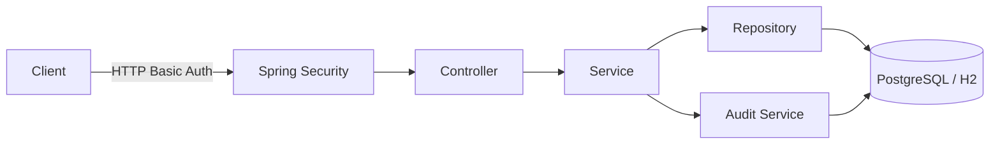

# Account Service

A secure Spring Boot REST API for user administration, role-based access control, payroll management, audit logging, and brute-force protection.

## Highlights

- Stateless HTTP Basic authentication with optional TLS
- BCrypt password hashing with strength 13
- Password length and breached-password validation
- Role-based authorization for administrators, users, accountants, and auditors
- Automatic account locking after repeated authentication failures
- Transactional payroll uploads with employee-period uniqueness
- Persistent security audit events
- Versioned Flyway database migrations
- PostgreSQL production storage with H2 local development
- Docker Compose development stack
- OpenAPI description and Swagger UI
- Spring Boot Actuator health and application information endpoints

## Technology

| Area | Technology |
| --- | --- |
| Runtime | Java 25 |
| Framework | Spring Boot 4.1 |
| Security | Spring Security, HTTP Basic, BCrypt |
| Persistence | Spring Data JPA, Hibernate, PostgreSQL, H2 |
| Migrations | Flyway |
| Validation | Jakarta Bean Validation |
| Containers | Docker, Docker Compose, Testcontainers |
| API documentation | OpenAPI 3, Swagger UI |
| Build | Gradle Wrapper |
| CI | GitHub Actions |

## Project structure

```text
src/
├── main/
│   ├── java/com/adham/accountservice/
│   │   ├── admin/       # User, role, and account-access administration
│   │   ├── api/         # Consistent API error handling
│   │   ├── audit/       # Persistent security-event recording and retrieval
│   │   ├── auth/        # Registration, passwords, users, and roles
│   │   ├── payment/     # Payroll upload, update, lookup, and formatting
│   │   ├── security/    # Authentication, authorization, and login protection
│   │   └── AccountServiceApplication.java
│   └── resources/
│       ├── db/migration/ # Versioned Flyway migrations
│       └── application.properties
└── test/
    ├── java/com/adham/accountservice/
    └── resources/application-test.properties
```

The code is organized by business feature. Each feature owns its controllers, services, DTOs, models, and repositories, keeping related behavior together.

## Request flow



## Running locally

Requirements:

- JDK 25
- No separate Gradle installation is required

Start the service:

```bash
./gradlew bootRun
```

On Windows PowerShell:

```powershell
.\gradlew.bat bootRun
```

The API starts at `http://localhost:28852`.

The default `dev` profile stores data in a local file-backed H2 database. Flyway creates and upgrades the schema; Hibernate only validates it.

The development profile bootstraps `admin@acme.com` with password `AdminPassword123`. These credentials are development-only and can be overridden through the `ADMIN_*` environment variables. Public registration always creates `ROLE_USER` accounts and accepts company email addresses ending in `@acme.com`.

Example registration:

```bash
curl \
  --header "Content-Type: application/json" \
  --data '{"name":"John","lastname":"Doe","email":"john.doe@acme.com","password":"VerySecure123"}' \
  http://localhost:28852/api/auth/signup
```

Interactive API documentation is available at `http://localhost:28852/swagger-ui.html`, and the machine-readable description is available at `http://localhost:28852/v3/api-docs`.

### Docker Compose

Start the production-style application and PostgreSQL stack:

```powershell
Copy-Item .env.example .env
docker compose up --build
```

Change the example passwords in `.env` before starting the stack. The containerized API is available over HTTP at `http://localhost:8080`; TLS is expected to terminate at a reverse proxy.

Stop the stack without deleting PostgreSQL data:

```bash
docker compose down
```

## API access

| Method | Endpoint | Required access |
| --- | --- | --- |
| `POST` | `/api/auth/signup` | Public |
| `POST` | `/api/auth/changepass` | User, Accountant, Administrator |
| `GET` | `/api/empl/payment` | User, Accountant |
| `POST` | `/api/acct/payments` | Accountant |
| `PUT` | `/api/acct/payments` | Accountant |
| `GET` | `/api/admin/user` | Administrator |
| `DELETE` | `/api/admin/user/{email}` | Administrator |
| `PUT` | `/api/admin/user/role` | Administrator |
| `PUT` | `/api/admin/user/access` | Administrator |
| `GET` | `/api/security/events` | Auditor |
| `GET` | `/actuator/health` | Public |
| `GET` | `/actuator/info` | Public |
| `GET` | `/swagger-ui.html` | Public |
| `GET` | `/v3/api-docs` | Public |

Protected endpoints use HTTP Basic credentials on every request because the API is stateless.

## Configuration

The `dev` profile is active by default. Set `SPRING_PROFILES_ACTIVE=prod` to use PostgreSQL. Configuration can be overridden with environment variables:

| Variable | Default | Purpose |
| --- | --- | --- |
| `SPRING_PROFILES_ACTIVE` | `dev` | Runtime configuration profile |
| `SERVER_PORT` | `28852` | Server port |
| `DB_URL` | Profile-specific | JDBC database URL |
| `DB_USERNAME` | Profile-specific | Database user |
| `DB_PASSWORD` | Required in `prod` | Database password |
| `ADMIN_BOOTSTRAP_ENABLED` | `true` in `dev` | Creates an administrator when none exists |
| `ADMIN_EMAIL` | `admin@acme.com` in `dev` | Bootstrap administrator email |
| `ADMIN_PASSWORD` | Development value in `dev` | Bootstrap administrator password |
| `SSL_ENABLED` | `false` | Enables application-level TLS |
| `SSL_KEY_STORE` | empty | External TLS key-store location |
| `SSL_KEY_STORE_PASSWORD` | empty | TLS key-store password |
| `SSL_KEY_ALIAS` | empty | TLS certificate alias |

Administrator bootstrap is idempotent: it creates an account only when no administrator exists. Disable it after provisioning production. Use externally managed secrets and certificates outside local development.

The former development certificate is kept locally under `.local/keystore/` and is ignored by Git and Docker. To enable local HTTPS, set the `SSL_*` variables explicitly.

## Testing and packaging

```bash
./gradlew clean check bootJar
```

The main suite uses an isolated in-memory H2 database and runs every Flyway migration before Hibernate validates the schema. When Docker is available, Testcontainers also runs the migration against PostgreSQL 17. The PostgreSQL test is skipped automatically on machines without a running Docker daemon.

The `check` task enforces minimum coverage of 80% for lines and 50% for branches. The HTML coverage report is produced under `build/reports/jacoco/test/html/`, and the executable JAR is produced under `build/libs/`.

The integration suite exercises registration, role-based authorization, payroll operations, audit access, brute-force account locking, account unlocking, and administrator protections through the real Spring Security filter chain.

## Error responses

Application and security errors use `application/problem+json` responses with a stable machine-readable code:

```json
{
  "type": "about:blank",
  "title": "Validation failed",
  "status": 400,
  "detail": "One or more request fields are invalid.",
  "instance": "/api/auth/signup",
  "code": "VALIDATION_FAILED",
  "timestamp": "2026-10-28T12:00:00Z"
}
```

Authentication failures intentionally return the same public message for unknown users, invalid passwords, and locked accounts to avoid leaking account state.

## Security events

The service records user creation, password changes, failed logins, access denials, role changes, user deletion, brute-force detection, and account lock/unlock operations. Audit records are persisted and available only to users with `ROLE_AUDITOR`.
